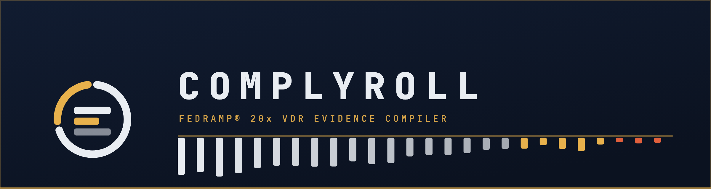

[![PyPI][pypi-badge]][pypi]
[![Python][python-badge]][pypi]
[![License][license-badge]][license]
[![CI][ci-badge]][ci]

**A local-first evidence compiler for FedRAMP® 20x Vulnerability Detection and Response (VDR).**

ComplyRoll turns scanner observations, validation runs, and operational evidence into traceable
vulnerability cases, class-aware response clocks, and official-format FedRAMP reports that a
provider can publish and an independent assessor can recompute.

ComplyRoll is pre-alpha. It does not produce a FedRAMP submission package and must not be
represented as FedRAMP approved.

## Quick start

Install the latest pre-release with `pip install --pre complyroll`. The walkthrough below uses the
synthetic sample files in this repository, so run it from a source checkout, with Python 3.11 or
newer:

```bash
git clone https://github.com/ComplyRoll/ComplyRoll.git && cd ComplyRoll
python3 -m venv .venv && . .venv/bin/activate && python3 -m pip install -e .

complyroll report vdt tests/fixtures/ubuntu-host.cklb tests/fixtures/windows-host.ckl \
  tests/fixtures/openscap-results.xml --class C --package-uri https://example.test/cpo \
  --from 2026-08-01T00:00:00Z --to 2026-08-31T23:59:59Z --as-of 2026-08-21T12:00:00Z \
  --detected-at 2026-08-01T00:00:00Z --evaluations examples/evaluations.json \
  -o report.json --markdown report.md
complyroll validate report.json --schema vulnerability-detail
```

The fixtures declare no scan time, so `report vdt` warns `source_timestamp_missing` three times
and `--detected-at` attests one. Next, record the same work as append-only history and
rebuild the report from it ([ADR 0008][adr-0008]). The two reports are byte-identical, so `cmp`
prints nothing:

```bash
complyroll ingest tests/fixtures/ubuntu-host.cklb tests/fixtures/windows-host.ckl \
  tests/fixtures/openscap-results.xml --db complyroll.db --as-of 2026-08-21T12:00:00Z
complyroll cases correlate --db complyroll.db
complyroll cases attest-detection --db complyroll.db --all-missing \
  --detected-at 2026-08-01T00:00:00Z --rationale "The fixtures declare no assessment timestamp."
complyroll cases evaluate --db complyroll.db --evaluations examples/evaluations.json
complyroll report vdt --db complyroll.db --class C --package-uri https://example.test/cpo \
  --from 2026-08-01T00:00:00Z --to 2026-08-31T23:59:59Z --as-of 2026-08-21T12:00:00Z \
  -o report-from-history.json --markdown report-from-history.md
cmp report.json report-from-history.json && cmp report.md report-from-history.md
```

The report includes internal resource identifiers and provider rationale, so redact it before
sharing with an agency. [`examples/README.md`][examples] continues from here with the other two
reports, SARIF, KEV, coverage and coverage gaps, HDF, failed imports, and the Python API.

## What it does

| Surface | What it does |
|---|---|
| CKLB, CKL, XCCDF, ARF, SARIF, HDF, and CycloneDX files | Become immutable observations with the artifact digest, parser identity, and timestamps |
| `complyroll report vdt\|avi\|historical` | Compiles the Vulnerability Detail, Accepted Vulnerability Information, or Historical VER Activity report, with a Markdown twin rendered from the same records |
| `complyroll validate REPORT --schema KIND` | Validates a report offline against the pinned official schema, with a JSON Pointer for each failure |
| `--kev FILE` | Matches each record's CVE identifiers to a CISA KEV catalog the operator supplies and carries its due date as the `VDR-TFR-KEV` clock, without fetching anything |
| `--inventory FILE` | Shows when detection last reached each resource the operator declares |
| `--changes FILE`, `complyroll changes pending` | Shows whether detection reached each resource a declared change touched, and writes the resources still waiting as a document for the pipeline that owns the scanner |
| `--record-failed-imports` | Records an artifact that cannot be parsed or holds no usable content, or a failed scanner invocation, as a vulnerability case of its own (`VDR-CSO-FAV`), and exits 3 |
| `--record-coverage-gaps`, `complyroll cases coverage` | Record coverage windows that closed with no verification as vulnerability cases (`VDR-CSO-FAV`), on a report run or into a store, and exit 3 |
| `--record-change-gaps`, `complyroll cases changes` | Record change windows that closed with no verification as vulnerability cases (`VDR-CSO-FAV`), one per change, on a report run or into a store, and exit 3 |
| `complyroll cases response-gaps` | Records a remediation a later scan contradicts and a planned reduction that passed unrecorded, which every report also warns about, and a case whose detection time was not attested in time, as system observations (`VDR-CSO-FAV`) in a store; each reaches the next report from the store that compiles (one refuses while a record lacks a detection time) and becomes a case at the next `cases correlate`. Exits 3 when it records one, 0 when it records none, a rerun included |
| `complyroll ingest`, `cases`, and `report --db` | Record the same work as append-only history and rebuild each report from it, byte-identical to the stateless report |
| `complyroll changes record` | Records each declared change in a store as history, for `report --db`, `changes pending --db`, and `cases changes` to read back |
| `complyroll store verify --db STORE` | Audits an event store's bytes and its domain, and exits non-zero on any fault |
| `stigroll FILE...` | The predecessor STIG roll-up, rebuilt on the hardened adapters and locked to its original output |
| `complyroll.adapters`, `.policy`, `.schemas`, `.store` | Ingest an artifact, calculate a deadline with its rule provenance, validate a report, or open the event store from Python |

Every command, flag, and exit status: [`docs/CLI.md`][cli].

What a result does not mean:

- A coverage gap or a change gap records that no verification reached a resource in time, not that
  the resource is vulnerable.
- A SARIF log with no results ingests as a PASS observation of the scope it names. That is evidence
  that the tool ran, not that the scope is clean.
- A CycloneDX SBOM with no vulnerability records, or an empty list, ingests as a NOT_REVIEWED
  observation of its subject. An inventory is not a detection, and a standalone VEX document is
  refused.
- A scanner pass may support a Key Security Indicator (KSI). It does not prove the complete KSI.

## Status

| Phase | Scope | State |
|---|---|---|
| 0 | Harden stigroll ingestion and provenance | Complete |
| 1 | Build VDR cases, policy clocks, and VER exports | Complete |
| 2 | Add automation, coverage, and change integration | Complete |
| 3 | Add response-process cases, KSI validation, and SDR evidence | Not started |
| 4 | Integrate trust-center and ongoing certification workflows | Not started |

Phase 2 closed on its exit criteria, with three deliverables moved on as a recorded scope change.
Not yet built, among others: failures in the response process as cases, a cloud, container, or
CSPM adapter, HTML report output, SPDX input, and KSI and SDR evidence.
[`docs/BUILD_PLAN.md`][build-plan] has the full list. `main` can be ahead of the PyPI pre-release,
and [`CHANGELOG.md`][changelog] says what is unreleased.

## Design rules

FedRAMP 20x is based on measured outcomes and persistent validation. A failed STIG rule or CVE is
only a source observation. VDR also covers drift, failed validation pipelines, stale security
decisions, supply-chain exposures, and failures in the detection and response process itself. So:

- Observations are immutable source facts, kept apart from stateful vulnerability cases.
- A case's Potential Agency Impact (PAIN) rating comes from the operator's evaluation. It is never
  derived from scanner severity, DISA CAT, or CVSS.
- Every deadline names its rule in the official FedRAMP rules dataset, pinned to one commit, and
  takes its timeframe from that rule. The KEV clock is the one exception: its rule comes from the
  dataset, but its due date comes from the CISA catalog the operator supplies.
- Grouping observations must not destroy affected-resource or source-level details.
- Human-readable and machine-readable reports must come from the same normalized records.
- Historical evaluations and evidence must remain reproducible.

## For independent assessors

ComplyRoll is meant to be run cold on provider-supplied artifacts: ingest the raw scanner exports,
recompute the clocks and the report, and compare against what the provider published. Every
deadline names its rule identifier, force (MUST or SHOULD), certification class, dataset commit,
and digest. The same artifacts, evaluations, options, and `--as-of` instant produce the same
bytes in any argument order ([`docs/ARCHITECTURE.md`][architecture] has the details). Assessors
do not configure or operate ComplyRoll on a provider's behalf; under the 2026 recognition rules,
advisory work on an offering bars assessing that offering for two years.

## Documentation

- [`examples/README.md`][examples]: worked runs on the synthetic fixtures, Python API included
- [`docs/CLI.md`][cli]: every command and flag, the exit status of each, and a worked example that
  writes a change file from `git log`
- [`examples/ci/`][examples-ci]: a reference GitHub Actions workflow and gate
- [`docs/BUILD_PLAN.md`][build-plan]: phased implementation plan and exit criteria
- [`docs/ARCHITECTURE.md`][architecture]: system boundaries and component design
- [`docs/DATA_MODEL.md`][data-model]: observation, case, evaluation, and evidence model
- [`docs/FEDRAMP_2026_MAPPING.md`][mapping]: current rule and schema mapping, and the FedRAMP
  sources ComplyRoll pins
- [`docs/SECURITY.md`][security-design]: threat model and evidence-handling requirements
- [`docs/decisions/README.md`][decisions]: index of the architecture decision records
- [`CHANGELOG.md`][changelog]: notable changes by release
- [`AGENTS.md`][agents]: repository rules and development commands

## Dependencies and data

ComplyRoll uses the Python standard library plus one declared runtime dependency, the
major-version-bounded `jsonschema` package with its non-GPL format extra, because the standard
library does not implement JSON Schema Draft 2020-12 (ADR 0006). The official FedRAMP rules
dataset and VER schemas are bundled unmodified and pinned to immutable upstream commits with
SHA-256 digests; see [`NOTICE`][notice] and [`src/complyroll/data/README.md`][data-readme] for
provenance and license.

## Contributing and security

[`CONTRIBUTING.md`][contributing] covers the development setup and the Developer Certificate of
Origin sign-off every commit carries. Report a vulnerability privately, as
[`SECURITY.md`][security-policy] describes, rather than in a public issue.

## License and disclaimer

ComplyRoll's code is licensed under the Apache License, Version 2.0 (see [`LICENSE`][license]
and [`NOTICE`][notice]). The bundled FedRAMP data files are works of the U.S. Government and are
not covered by that license. The ComplyRoll name is not licensed (Apache License, Section 6).

ComplyRoll is informational tooling, not legal or compliance advice. A report that validates
against an official schema satisfies that schema's minimum structure; it is not a FedRAMP
determination, and the provider remains responsible for meeting the Consolidated Rules. Verify
every clock against <https://www.fedramp.gov/2026/> before relying on it.

FedRAMP® is a registered trademark of the U.S. General Services Administration. ComplyRoll is an
independent project and is not affiliated with, endorsed by, or approved by GSA or the FedRAMP
Program Management Office.

[pypi-badge]: https://img.shields.io/pypi/v/complyroll?include_prereleases&label=pypi
[python-badge]: https://img.shields.io/pypi/pyversions/complyroll
[license-badge]: https://img.shields.io/badge/license-Apache--2.0-blue.svg
[ci-badge]: https://github.com/ComplyRoll/ComplyRoll/actions/workflows/ci.yml/badge.svg
[pypi]: https://pypi.org/project/complyroll/
[ci]: https://github.com/ComplyRoll/ComplyRoll/actions/workflows/ci.yml
[adr-0008]: https://github.com/ComplyRoll/ComplyRoll/blob/main/docs/decisions/0008-persisted-history-and-event-sourced-rebuild.md
[agents]: https://github.com/ComplyRoll/ComplyRoll/blob/main/AGENTS.md
[architecture]: https://github.com/ComplyRoll/ComplyRoll/blob/main/docs/ARCHITECTURE.md
[build-plan]: https://github.com/ComplyRoll/ComplyRoll/blob/main/docs/BUILD_PLAN.md
[changelog]: https://github.com/ComplyRoll/ComplyRoll/blob/main/CHANGELOG.md
[cli]: https://github.com/ComplyRoll/ComplyRoll/blob/main/docs/CLI.md
[contributing]: https://github.com/ComplyRoll/ComplyRoll/blob/main/CONTRIBUTING.md
[data-model]: https://github.com/ComplyRoll/ComplyRoll/blob/main/docs/DATA_MODEL.md
[data-readme]: https://github.com/ComplyRoll/ComplyRoll/blob/main/src/complyroll/data/README.md
[decisions]: https://github.com/ComplyRoll/ComplyRoll/blob/main/docs/decisions/README.md
[examples]: https://github.com/ComplyRoll/ComplyRoll/blob/main/examples/README.md
[examples-ci]: https://github.com/ComplyRoll/ComplyRoll/blob/main/examples/ci/README.md
[license]: https://github.com/ComplyRoll/ComplyRoll/blob/main/LICENSE
[mapping]: https://github.com/ComplyRoll/ComplyRoll/blob/main/docs/FEDRAMP_2026_MAPPING.md
[notice]: https://github.com/ComplyRoll/ComplyRoll/blob/main/NOTICE
[security-design]: https://github.com/ComplyRoll/ComplyRoll/blob/main/docs/SECURITY.md
[security-policy]: https://github.com/ComplyRoll/ComplyRoll/blob/main/SECURITY.md
